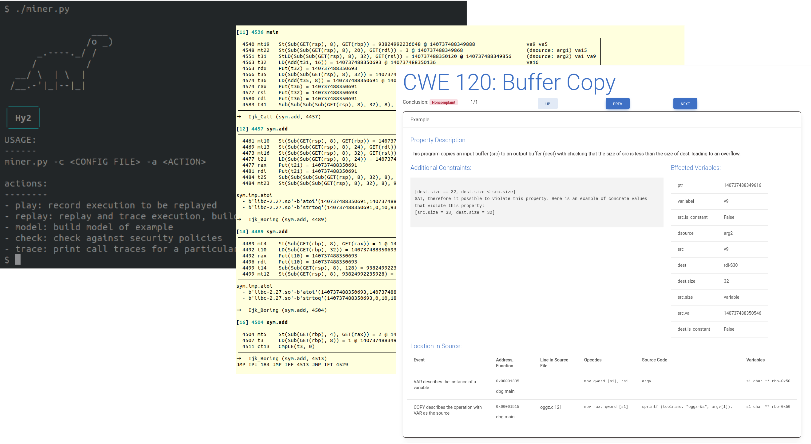
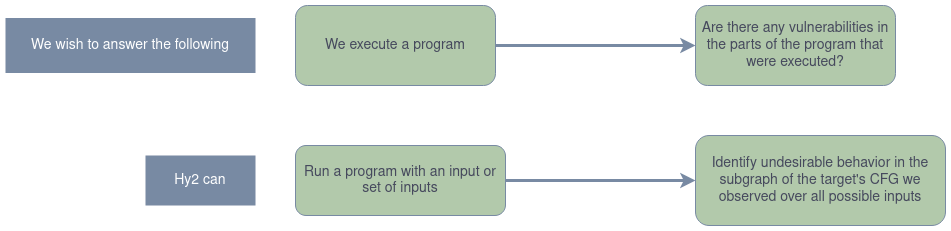
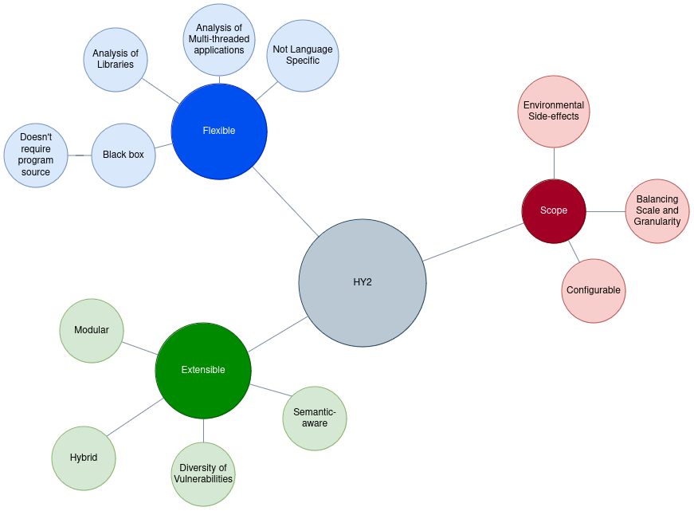
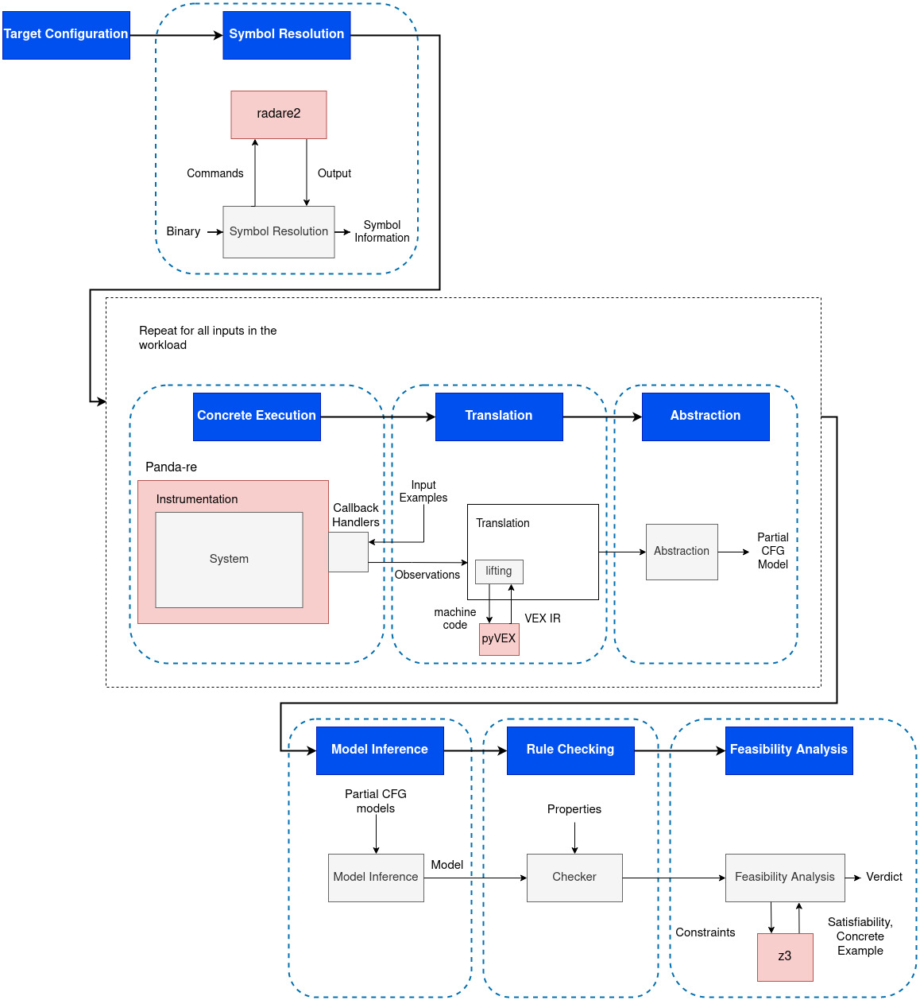
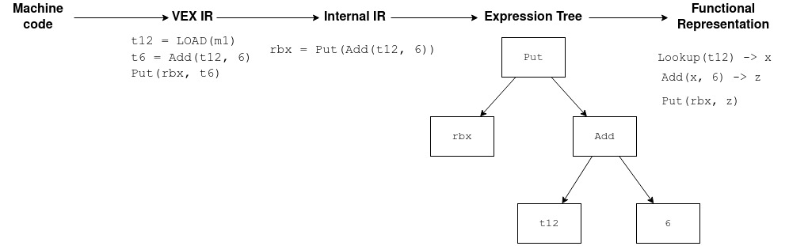
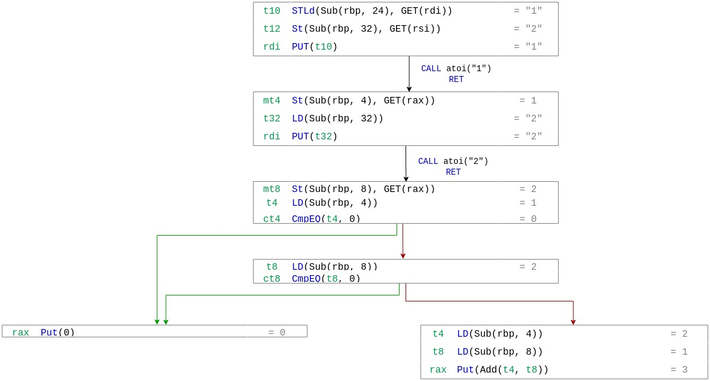

Hy2 is a hybrid vulnerability analysis method built on the panda-re full-system emulator. It is designed for binary analysis and combines ideas from model-checking and runtime verification.

> I created this tool for my Master's thesis in 2023. Here is a link: [https://carleton.scholaris.ca/items/58fa7067-f04d-4827-a210-1b26121dc982](https://carleton.scholaris.ca/items/58fa7067-f04d-4827-a210-1b26121dc982) DOI: 10.22215/etd/2023-15772

**In a nutshell**:
- Hy2 takes in a binary
- Executes it on an orchestrated system, collecting runtime data
- Builds a CFG-based model from this data, and augments it with debug information if available
- Checks rules against this model. Rules describe errors and other undesirable behavior that may result in vulnerabilities, and reports any violations of these rules to the user.

This tool includes a web interface, and a DSL for describing security properties.

> ⚠️ **Note**: This doesn't work on later versions of Ubuntu (after 20.04) because pandare is not supported. This is largely a prototype, some parts need further development, and there may be bugs. 2023 was a long time ago, and I was fixing some things when I started work, that being said - I am not sure in what state I left things

See `docs/` for complete documentation.

### Features/Design Goals:

## How it Works

#### Analysis Process Overview:

Hy2 is built on a full-system emulator, we use callbacks to collect information about the target and the environment as it is executed. The analysis performed on runtime data produced by a single program execution is comparable to that performed by a decompiler.

#### Definitions:

* Guest System: refers to the operating system being run in the emulator.
* Target Program: refers to the program being evaluated. This may not always be a single program, but could be multiple different programs, libraries, or part of the system itelf.
* Environment: refers to everything running on the system except the target program.
* Input Example: refers to an input used to exercise the target program. In this case exercise means to trigger the execution of some part of the target program. Input examples should be designed to exercise the different functionalities of the target program. In this case they should take the form of a command that can be run in the terminal.
* Workload: refers to the set of input examples used to exercise a target program

A summary of the steps in our analysis process:
* **Target Configuration** - where we specify how to execute the target, including the workload - this being the set of inputs to exercise the target program with
* **Symbol Resolution** - where we introduce debug symbols, and create a map of basic blocks within the binary

We repeat these next 3 steps over all inputs in the workload
* **Concrete Execution**:
    * run the program with the particular input example in the orchestrated guest
    * trace program execution at a basic block level
    * build a linear model of its execution and interactions with the environment
* **Translation**:
    * For each unique basic block observed at execution we convert the machine code into an IR
    * Merge instructions into more complex expressions (eg. `X = GET(r), Y = ADD(X, 1)` becomes `Y = ADD(GET(r), 1)`)
    * Convert these expressions into our internal IR
    * Introduce concrete values, and debug info
    
* **Abstraction**:
    * Using the observed sequence of basic blocks executed we derive a CFG model describing the subset of program behavior observed at program execution. We refer to these as partial CFGs.
    * Perform data-flow analysis
    * Key part of our approach is that describing the entire state-space is not a necessity for the completion of our analysis
    * We use over-approximation - using type to define variable domains
        * i.e. if a external function returns a u64 we consider that its output could be any value in the range that a u64 could have
    * Concrete values to describe invariants - reduces size of state space
    
    
* **Static Analysis Extension**: We can optionally simulate the behavior of the program on unseen branches

With the partial cfg models created from the previous 3 steps:

* **model-inference** - merge partial CFG models into a single model that describes the program behavior observed across the execution of the entire workload.
* **rule-checking** - check rules against our program model
* **Feasibility Analysis** - determine if the undesirable behavior we identified in our model is actually possible in the program itself, because the model is an over-approximation - so contains behaviors not in the actual program.

### Why?

- Visibility into environmental side-effects
    - such as concurrency, interactions with other programs and the underlying system
- Allows for the testing parts of large programs
- Hybridization of static and dynamic analysis
    - allows for variable granularity - which parts the program do we want to look in detail
    - uses a concrete memory representation - something static analysis techniques struggle with is building a model of memory
    - doesn't require source code

### Limitations:

With our evaluation we identified several limitations of our method, these being:
* Cost of Analysis
    * Specifically the time required for analysis makes this method less than practical
* Precision
    * OS side-effects - unobservable, may influence behavior of the program in unintended ways
        * Applications that use multi-threading, the order of operations when the program is executed is influenced by the scheduler
    * Data-flow approximation - less precise, the source of spurious results, we can describe that variables are related but not the relationship between variables
* Coverage
    * Only as good as the specified workload, limited by the input examples provided by the user
* The Role of the User
    * User-effort -- interpret the results and configure how we analyze the target - primarily specifying input examples to make up the workload may be time consuming

### Documentation:

* [Overview](docs/README.md)
* [Configuration Options](docs/configuration_options.md)
* [Installing Hy2](docs/installation.md)
* [Hy2 property language guide](docs/lang.md)
* [Usage Example](docs/usage.md)
* [Bugs and Issues](docs/ISSUES.md)

