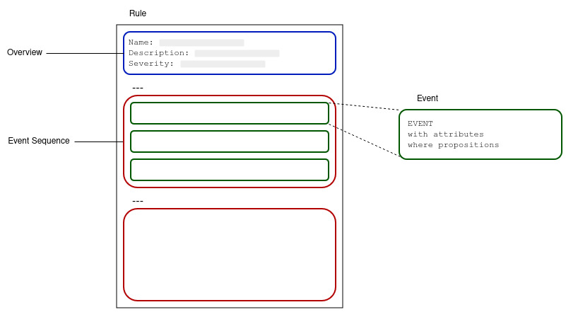

# Hy2 Lang Syntax Guide:

This document describes the structure and syntax of our property language (ie. the language used create properties or rules to describe undesirable behaviors that are checked against program models).

### Conversion:

Properties are written in our dsl and then converted to json by a conversion script. They must in json format to checked against program models. This conversion is done as follows:

```
./translate.py -p dsl/cwe_126_out_of_bounds_write.txt
```

## Structure:

Properties consist of sequences of events which have attributes and propositions.



The format of events are as follows:
```
EVENT
with attributes
where propositions
```

- `with` - (optional) proceeds a list of attributes
- `NOT` - describes events which if they occur on the error path, then it will not violate the property. If we have for instance the rule `A then B then NOT C then D`, then the sequence `ABACD` will not be returned, but the sequence `ACBD` would be.
- `where` - (optional) proceeds a list of propositions
- `if` - a data-based constraint, checked seperately from propositions. Evaluates whether it is possible for a condition to be satisfied for all possible input values. Useful for memory errors.
- `OR`, `AND` - used in propositions to describe relationships between then.
- `WHERE` - used to indicate relationships between NOT statements. 

A simple example is the following: FIO-46: Do not access a closed file. This can be described as "A file with file pointer fp is closed and then accessed without being opened":
```
---
FCLOSE
with fp = fp

NOT FOPEN as a0

NOT RET as a1
with newfp = val
where fp != newfp

FACCESS
with fptr = fp
where fp == fptr

WHERE a0 AND a1
---
```

#### An example with a data-based constraint:

A simplified example of our write-out-of-bounds property. In for this property we check if the allocated size of the buffer is less than or equal to the offset in the buffer being written too, in which case a write out-of-bounds occurs.

```
---
ALLOCATE
with n = size, fname = fname

RET
with addr = val, returned_from = ret.fname, addr.label = label
where returned_from = fname

NOT FREE
with eol_addr = ptr
where eol_addr == addr

STORE
with base = base, offset = offset
where ptr like base
if n <= offset
```

## Syntax:

Actions:
- `VAR` - access to a memory location, includes load and store
- `STORE` - store action, write to a memory location
- `LOAD`- load action, read from a memory location
- `PUT` - put action, store value in register
- `VAR*` - any access to "variables" includes load, store, and put actions
- `COND` - a condition
- `RET` - use of the value returned from a function
- `LOOPHEADER` - block with a backedge to it (the start of the loop)
- `EDGE` - the backedge in the loop
- `CALLRET` - return from function call
- `CALL` - call action

We also use aliases to describe groups of functions with a single keyword, see `properties/json/lib.json` for these.

Attributes:
- `fname` - current function name
- `size` - 
`is_constant` - boolean - whether the value assigned to a variable changes (ie. is it hard coded in the program)
- `val` - concrete values observed for a variable
- `addr` - concrete addresses observed for a variable
- `ret.fname` - function name we have just returned from
- `label` - label - identifiers used to keep track of data-flow
- `ls.ls` - gets the label for the left x 2 branch of the expression tree, matches on statements in form STORE(base + offset, value) for which it would retrieve base.
- `ls.rs` - gets the label for the left then right branch of the expression tree, matches on statements in the form STORE(base + offset, value) for which it would retrieve offset. The attribute `ls.rs.is_constant` can also be used.
- `base` - get the label from the left branch of the expression tree
- `offset` - equivalent to `ls.rs` attribute 
- `var.name` - gets the string identifier assigned to each variable expression
- `dsource` - the source of a value (either returned from a function call, or input args to a function call)  
- `dintent` - the use of a value (ie. for input args used in a function call)
-  `ls.dsource`, `rs.dsource` - the data source for the left and right sides of the expression respectively
- `ls.var`, `rs.var` - get the string identifier assigned to the variable expressions used by in the left and right side of an expression. eg. COND(ls, rs) where ls and rs are defined earlier in the block
- `op` - The specific operation being performed
- `ls.val` - the concrete value of the left side of the expression
- `rs.val` - the concrete value of the right side of the expression
- `dtype.size` - if the debug info is available, and a data type is given to a variable, the size in bytes occupied by that particular data type.
- `pc` - program counter - concrete address of instruction
- `ls.label`, `rs.label` - get the label for the left and right hand sides of an expression respectively
- `jmp.dest` - the destination of a jmp statement (ie. where does the edge in the cfg go to)
- `ls.op` - the operation being performed on the left side of the variable expression
- `rs.op` - the operation being performed on the right side of the variable expression

Actions with Applicable Attributes:

`EDGE`:
- pc
- fname
- jmp.dest

`CALL`:
- label
- dep
- ls.op
- dsource
- size
- val
- addr
- is_constant

`CALLRET`:

`PUT`, `VAR*`:
- deps
- var.name
- val
- dtype.size
- ls.op
- ls.ls
- ls.rs
- dintent
- dsource
- label

`RET`:
- var.name
- addr
- val
- label
- def
- ret.fname

`LOOPHEADER`:
- pc
- fname

`LOAD`, `VAR`, `STORE`:
- fname
- name
- tid
- val
- dtype
- dsource
- ls.dsource
- addr
- base.label, ls.label
- base
- is_constant
- label
- dtype.size
- ls.ls
- ls.rs
- ls.rs.dsource
- ls.rs.is_constant
- rs.ls
- rs.rs
- rs.rs.is_constant

`COND`:
- op
- tid
- ls.label
- rs.label
- rs.val
- ls.var
- ls.val
- dsource