## Usage Example

This document covers the basic workflow for analyzing an application.

We use the toy program `file_manager` as an example, and walk through all the steps to analyze it.

The particular example has a CLI that allows you to perform various operations on a file. An example usage:
```
$ ./file_manager test.txt
Opening file ..... test.txt 

1 - read file
2 - write file
3 - append file
4 - delete file
0 - quit
>> 1
Hello World
```

Using the web application to perform the initial setup is easiest, so we use it here.

Navigate to Targets, and Click "New":
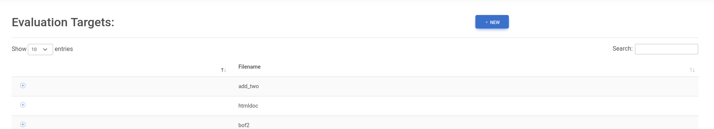

To add our target `file_manager` we are required to specify the configuration required to specify how to execute the target in the orchestrated guest.

Fill in the form:
* Target Name - the name the target program is refered to through out the analysis
* Target pages - the name(s) of the pages to analyze (in most case the same as the binary name)

We leave the remaining fields set to the default (see `docs/configuration_options.md` for a complete description of all configuration options).

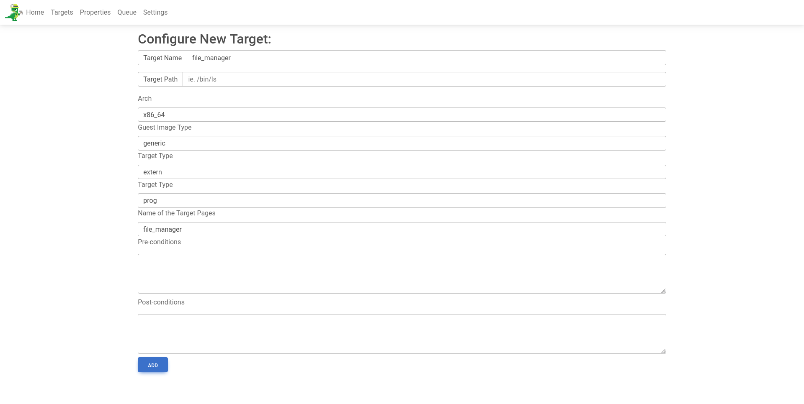

This creates a folder for `file_manager` in `targets` and a config file `profile.json` in this folder.

Next we need to perform the symbol resolution step. 

To do this naviagate to "Queue", and add task `{"target": "file_manager", "task": "symbol resolution"}` to the queue and click "Update".

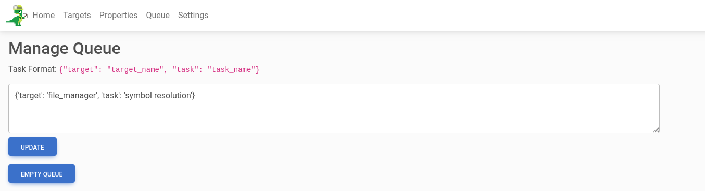

Then run `python3 run_queue.py`

To have the lines in source shown with the reported error, create folder `dbg/src` in `targets/file_manager` and copy the source into it.

Next we want to add an input example to exercise the target application (ie. use the execute the target program)

Navigate to target page and click Configure:

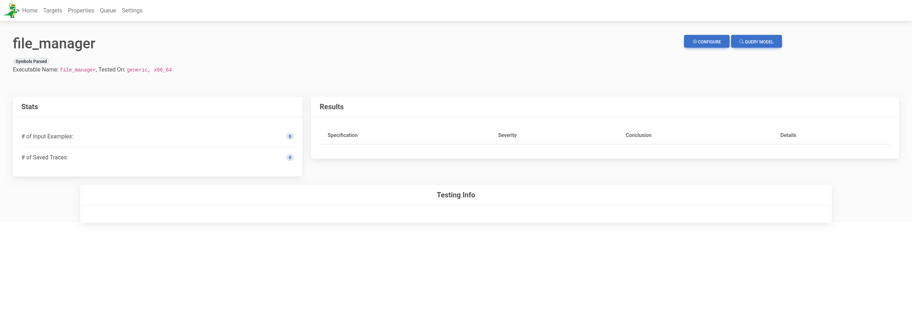

Navigate to Input Examples and click "Add Test Case":

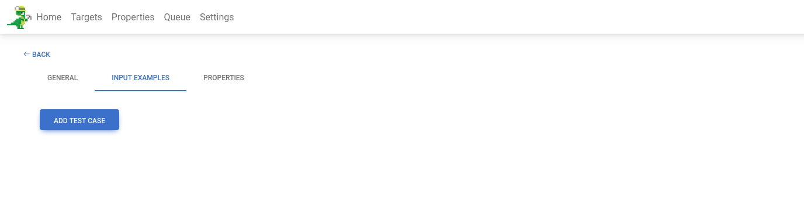

If for example we want to create an input example that appends "hello" to the file `/tmp/test.txt`, we enter the associated inputs in text box as shown, with each interaction with the guest being a seperate command and click "Add":

```
{"cmd": "./file_manager /tmp/test.txt", "type": "async"},
{"cmd": "3", "type": "async"},
{"cmd": "hello", "type": "async"}
```

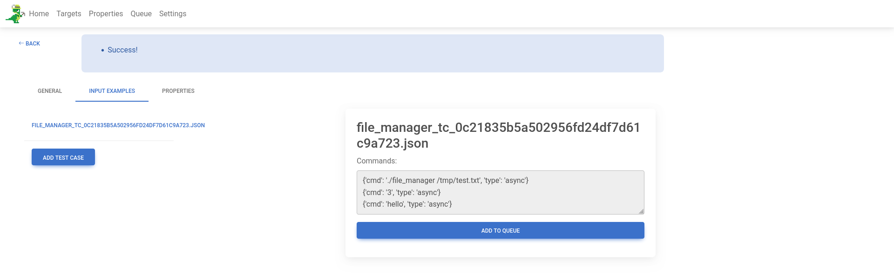

A configuration file for this input example is created on disk in the folder `targets/file_manager` which tells `hy2` how to perform its analysis for this input example.

We also may want to select which properties to test against the program. This can be done in the prooperties tab.
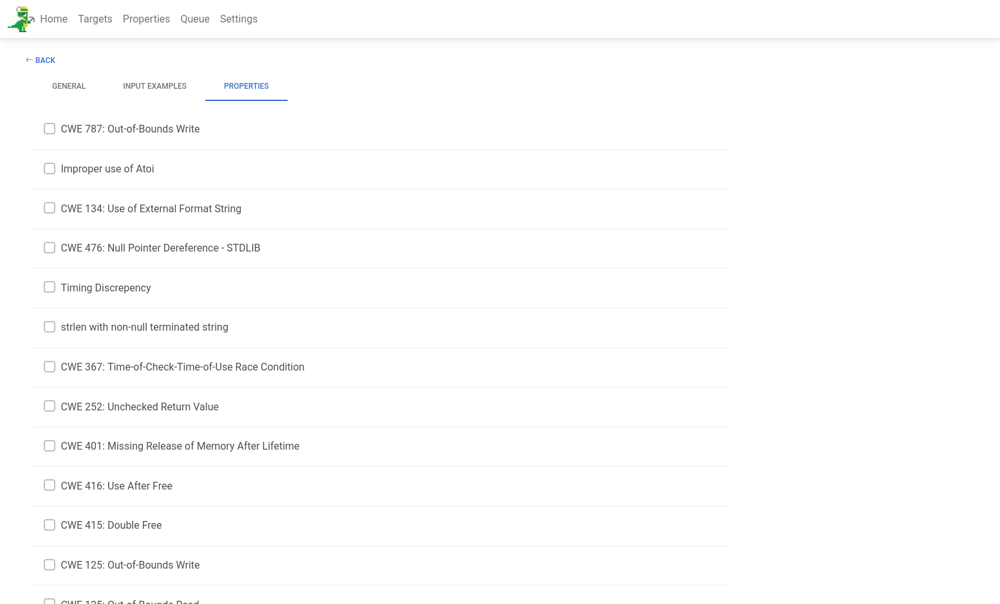

Next we want to run the input example.

Go to "Queue" and add target name to queue with task 'trace' to run and analyze all input examples:

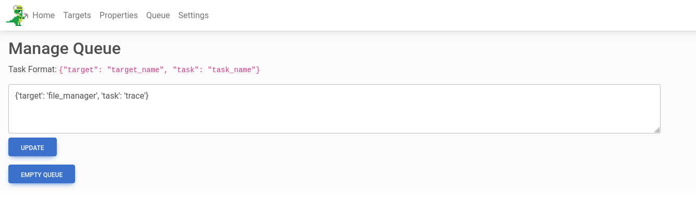

When `run_queue.py` is executed it will run all jobs in the queue.

After the input examples are executed we need to create a program model. You could either add a job to the queue like so:
```
{"target": "file_manager", "task": "model"}
```
or use the CLI:
```
./miner.py -c file_manager -a model
```

Finally, we need to check the model against our properties. You could either add a job to the queue:
```
{"target": "file_manager", "task": "check"}
```
or use the CLI:
```
./miner.py -c file_manager -a check
```

Then hy2 will spit out some results.

### Results:

To view results for a target program navigate to its page within the web app, and you should see the results listed.
Then click "View" to view information about a particular result.

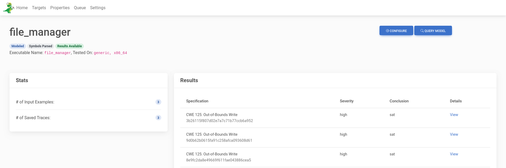

At the top the "up" arrow can be used to return to the profile page, and the "left" and "right" arrows can be used to view the previous and next results in the list on the previous page.

The results page consists of 3 parts:
1. Location in Source/Binary - maps the results to lines in the source or locations in the program binary 
2. A Feasibility Analysis - describes under what conditions the error may occur, using concrete values. Describes the conditions on the error path, and concrete values of variables that are involved.
3. A description of the error path using the program model created by hy2. This is admittedly very hard to interpret.

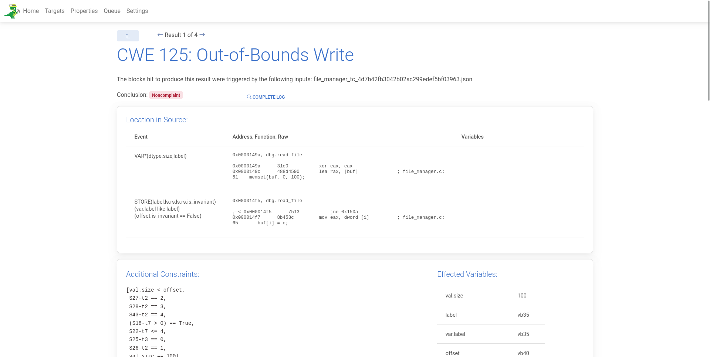

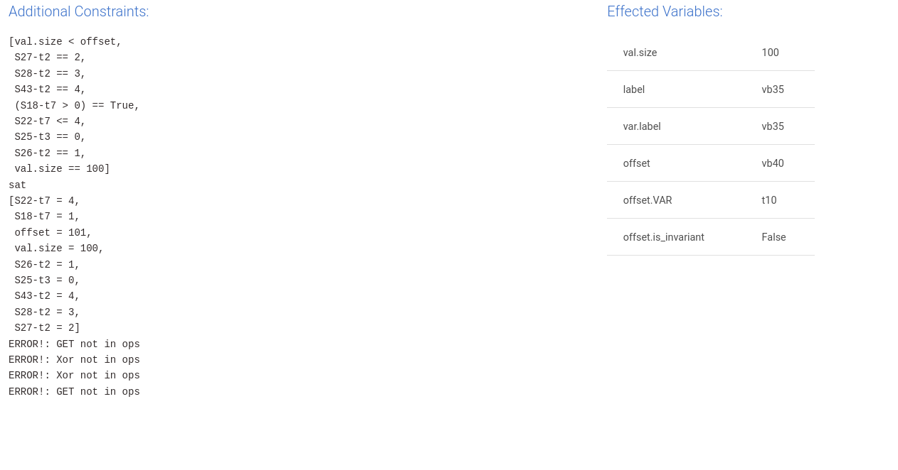

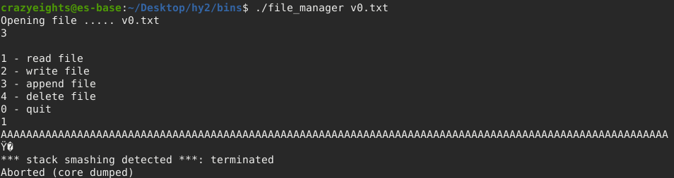

By clicking on "Complete Log" we can also see the lines in source that triggered the error, if the source and debugging info is available.

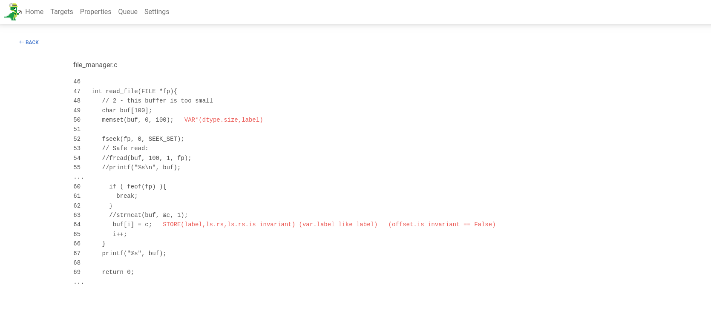


